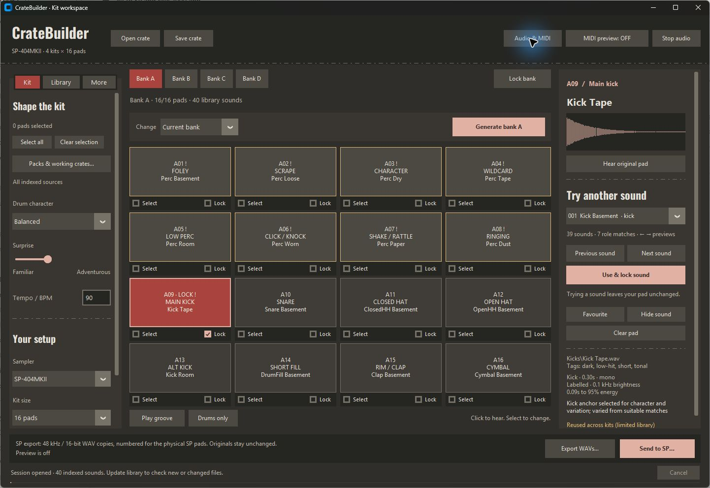

# CrateBuilder

**[Download the Windows app](https://github.com/diamond-one/CrateBuilder/releases/latest)** — extract the ZIP and open **CrateBuilder.exe**.

Make drum kits from the samples you already own. Generate a bank, hear the pads, keep the sounds you like and replace the rest. Export to **SP-404MKII** or **MPC1000**.



*The screenshot uses generated demonstration sounds. Sample packs are not included.*

## Make your first kit

Allow **about five minutes for setup**, plus your first library scan. Scan time depends on the number of files and drive speed.

1. Open **Library**. Choose your sample folder with **Browse**.
2. Press **Update library**. Originals stay in their existing folders.
3. Open **Kit**. Choose your sampler and **8 pads** or **16 pads**.
4. Press **Generate bank A**. Click a pad to hear it.
5. Use **Send to SP**, **Export WAVs** or **Export MPC** when the kit feels right.

Later scans reuse unchanged analysis. You can close and reopen the app to continue your autosaved crate.

## Replace one sound

1. Click the pad you want to change.
2. Use **Previous sound**, **Next sound**, or the alternatives menu to audition replacements. **Hear original pad** plays the current assignment for comparison.
3. Press **Use & lock sound** to keep your choice. Unlock that pad when you want generation to change it again.

Trying alternatives leaves the pad unchanged. **Space** hears the pad, **Left / Right** tries alternatives, and **Esc** stops audio. The inspector names the sound being auditioned.

Use **Browse all sounds** to search the wider collection and explicitly place a suitable sample on the selected pad. **Favourite** bookmarks a sound; **Unfavourite** removes the bookmark. **Hide sound** excludes it from future generation without deleting the file or clearing its current pad.

## Generate only what you want

| Change | What generation replaces |
| --- | --- |
| **Current bank** | Unlocked pads in the visible bank. |
| **Selected pads** | Only pads with **Select** ticked. Ctrl-click also selects. |
| **Upper 8** | Percussion and foley in the current 16-pad kit. |
| **Whole crate** | Unlocked pads across banks A–D. |

**Locks protect sounds in every scope.** **Lock bank** protects the whole bank. Unlocking a bank preserves its individual pad locks. Switching banks keeps the other banks' sounds; the generation selection clears.

In 16-pad mode, the lower eight hold core drums and the upper eight add percussion, foley and character. In 8-pad mode, each bank contains two kits. Four banks hold **64 pad positions**.

**Drum character** shapes matching. **Surprise** widens the choices from familiar to adventurous. Generation avoids previous sounds when suitable alternatives exist. A warning explains substitutions or limited choices.

## Hear the kit through MIDI

1. Connect your controller. Open **Audio & MIDI** to choose its input and your listening output.
2. Press **MIDI preview: OFF** to switch preview on.
3. Play the hardware pads. Press the same button to switch preview off.

The computer plays the samples. MIDI preview does not import them into your sampler. For an SP-404MKII, use **MIDI Mode A**, **PAD Note Out ON**, an empty hardware bank and **USB In → MIX OUT**.

The normal output list hides duplicate Windows drivers. **Advanced** provides the full list, MIDI channel, note offset and pad learning. Other controllers can use a learned mapping.

## Export to your sampler

### SP-404MKII

Connect USB and press **Send to SP**. Check the connected project, choose a destination bank and review the pad map before sending. The app prepares compatible **48 kHz / 16-bit WAV** copies.

**Replace occupied pads** is off by default. Replacing them requires a local recovery backup, saved before writes begin. Cancellation stops between pads; completed transfers remain on the SP. Recovery backups require manual restoration.

**Export WAVs** creates copies and a pad map for importing separately. SP kit delivery uses the current kit; it does not configure mute groups or pad effects.

### MPC1000

Choose **MPC1000** under **Your setup**, then press **Export MPC**. Copy the **whole exported folder** to your card and load its `.PGM` from the MPC's LOAD screen.

One program contains all four banks, with **44.1 kHz / 16-bit WAV** samples. The writer uses classic MPC1000 PGM 1.00, not XPM. Physical loading needs broader testing across Akai OS and JJOS versions.

## Keep a large sample collection manageable

1. **Library → Tag folders** gives an entire folder a role and tags. New files inherit the rule; no renaming is needed.
2. **Import expansions** indexes installed NI sample folders without moving them. Pick active packs before analysing their drums.
3. **Packs & working crates** saves source selections and filters. Mix active packs or keep generation within one pack.
4. **Browse collection** searches paged results, with pack, category, favourites, hidden and recent-use filters.
5. **Export selected** copies only the sounds you selected into folders organised by pack and category, with verified copies and manifests.

Loops and instruments remain separate from automatic drum pools. Short musical one-shots can be placed manually. NI synth presets and Maschine effects are not rendered.

Keep network or cloud samples available offline for audition and export. Unavailable folders keep their cached records while healthy sources update. Online-only cloud files are deferred until downloaded.

## If something does not work

| Problem | First action |
| --- | --- |
| No sounds available | Open **Library**, choose a folder and **Update library**. |
| Generation keeps a sound | Check pad/bank locks, source filters and whether suitable alternatives exist. |
| Pads respond silently | Choose the output you hear through in **Audio & MIDI**. |
| A sound is unavailable | Reconnect its drive or download the cloud file, then update the library. |
| Too few role matches | Add samples, relax source filters, or allow role substitutes in **More**. |

**Save crate** creates a named editable session referencing your originals. App data, tags, favourites and recovery state live in `%LOCALAPPDATA%\CrateBuilder`. Back up that folder and your saved sessions. `CRATEBUILDER_DATA_DIR` can provide a separate local data folder.

<details>
<summary>Run from source, build and verify</summary>

Python 3.12 is used for the Windows build.

```powershell
python -m venv .venv
.\.venv\Scripts\python.exe -m pip install -r requirements.txt
.\.venv\Scripts\python.exe run.py
```

Build and test:

```powershell
.\.venv\Scripts\python.exe -m pip install pyinstaller==6.22.2
.\build.ps1
.\.venv\Scripts\python.exe -m unittest discover -s tests -v
.\.venv\Scripts\python.exe tests\ux_smoke.py
```

The build produces `dist\CrateBuilder.exe`. Its `--self-check report.json` option uses generated fixtures and does not write to physical samplers. See [VALIDATION.md](VALIDATION.md) for this release's evidence and limits.

`python run.py --help` lists command-line scanning, folder tags, conversion and export options. CLI defaults remain 8 pads / MPC for compatibility; the desktop defaults to 16 pads / SP.

</details>

## Credits and sample ownership

Your audio stays local. Exports create copies; original files are never edited. Sample licences still apply to exported kits.

The PGM template and independent test parser come from [Stephen Norum's pympc1000](https://github.com/stephenn/pympc1000), under the zlib licence. [SparkyMK2](https://github.com/TuscanPL/SparkyMK2) supplies the separate SP USB helper under GPL-3.0-or-later; matching source accompanies the Windows release. Oswald is bundled under the SIL Open Font License. Notices are in [licenses](licenses).
